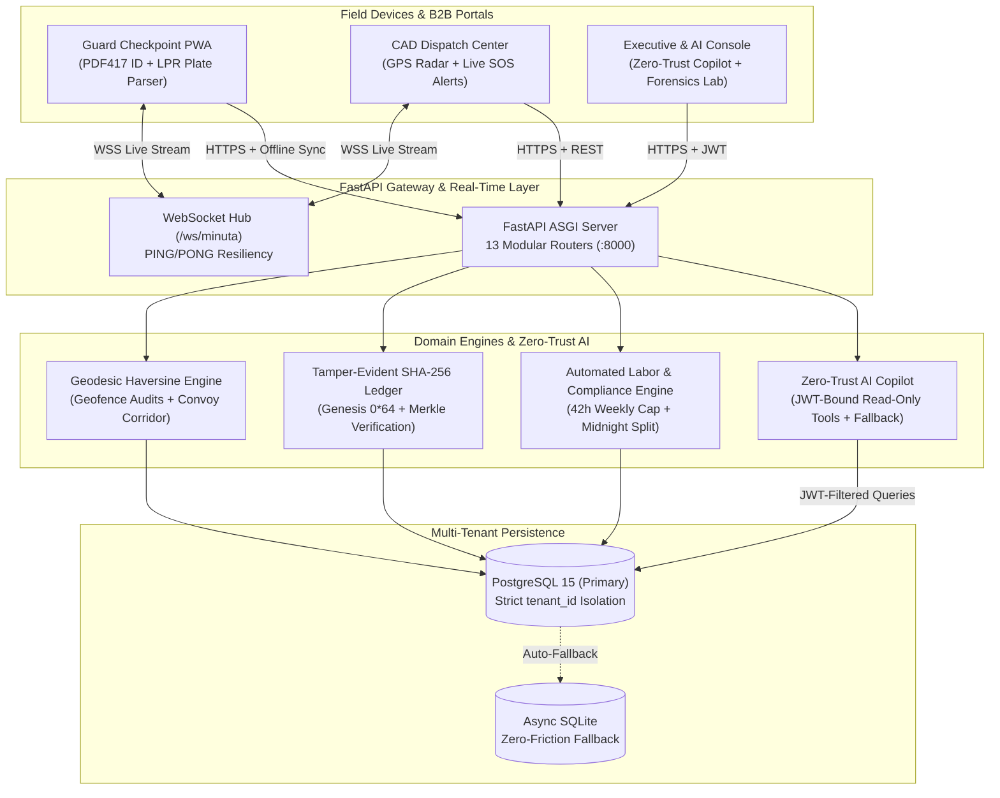

# SENTINEL // OPS (Enterprise Release V5.1) — B2B SaaS Operations, Telemetry & Compliance Platform

> [Leer documentación en Español](./README.es.md)

[](https://github.com/KievDxD/Sentinel-Ops/actions/workflows/ci.yml)


Production-grade **Multi-Tenant B2B SaaS Platform** engineered for private security, critical infrastructure protection, and workforce compliance operations (built around Colombian regulatory standards: SuperVigilancia, Law 2101 42-hour workweek, Indumil DCCA ballistics, SARLAFT 2.0 AML screening, and Decree 1072 Occupational Health & Safety).

SENTINEL // OPS unifies real-time WebSocket command-center dispatching (CAD), Haversine GPS geofenced patrols with Offline-First synchronization, a **Tamper-Evident SHA-256 Ledger** across operational logs and ballistics inventory, an **Automated Labor & Compliance Rules Engine**, BASC/ISO-28000 armored escort telemetry, K9 unit fatigue management, and a **Zero-Trust AI Tactical Copilot** with read-only SQLAlchemy tool calling and deterministic fallback.

---

## 1. Core Architectural Pillars & Tech Stack

| Layer | Technologies | Engineering Highlights |
| :--- | :--- | :--- |
| **Frontend Command Console (SPA/PWA)** | React 18, TypeScript 5, Vite 5, Tailwind CSS, Lucide, Axios, Zustand | High-contrast sunlight-ready Tactical Field Mode, per-tab `sessionStorage` auth isolation, 1-click recruiter demo login across 5 RBAC roles, and Rollup `manualChunks` code splitting (`0` bundle warnings). |
| **Backend API Gateway** | Python 3.12 / 3.15, FastAPI, Uvicorn (ASGI), Pydantic V2 | 13 modular REST routers + bi-directional WebSocket hub (`/ws/minuta`) with PING/PONG heartbeat and automatic stale-socket eviction. |
| **Zero-Trust AI Copilot** | Tool Calling + Deterministic SQL Fallback (`LLM_API_KEY` optional) | Context (`tenant_id`, `role`, `puesto_base_id`) injected strictly from server-verified JWT claims—never from user payloads. Includes prompt-injection detection, read-only SQLAlchemy tools, and zero-500 offline deterministic fallback. |
| **Tamper-Evident SHA-256 Ledger** | Chained SHA-256 Hash Ledger (`"0"*64` Genesis) + Merkle Root | Cryptographic hash chaining across digital logbooks, shift handovers, ballistics ledgers, BASC escort manifests, and AML certificates, with an interactive Forensics Lab capable of live tamper detection and self-healing recovery. |
| **Automated Labor & Compliance Engine** | Python `ZoneInfo("America/Bogota")`, Midnight-Split Engine | Calculates shifts across calendar-day midnight boundaries (`00:00:00`), enforces dynamic 42h weekly overtime cutoffs (Law 2101), night/Sunday premiums, SuperVigilancia license expiration blocks, and statutory B2B pricing (Art. 462-1 E.T.). |
| **Multi-Tenant Persistence & Demo Self-Reset** | PostgreSQL 15 + Async SQLite Fallback, SQLAlchemy 2.0 Async | Strict row-level `tenant_id` isolation, automatic fallback to `aiosqlite` if PostgreSQL is unreachable, and a lightweight 24h background lifespan task (`MODO_DEMO=True`) to keep live demo environments clean. |

---

## 2. System Architecture



---

## 3. Enterprise Capabilities

### 3.1. Zero-Trust AI Tactical Copilot (`POST /api/inteligencia/copiloto`)
- **Strict Context Injection:** `tenant_id`, `rol`, and `puesto_base_id` are extracted exclusively from the verified JWT dependency (`obtener_usuario_actual`), preventing payload spoofing or horizontal privilege escalation.
- **Prompt Injection & Cross-Tenant Guardrails:** Detects SQL/prompt injection directives and cross-tenant identifiers (`EMPRESA-*`), enforcing tenant isolation and blocking `CLIENTE` accounts with `HTTP 403` whenever another site/post is referenced.
- **Read-Only Context-Bound Tools:**
  1. `obtener_alertas_vencimiento`: Audits expiring/expired SuperVigilancia licenses, Indumil firearm permits, and 5-year Kevlar ballistic vest lifespans.
  2. `analizar_riesgos_operativos_y_sla`: Evaluates GPS/QR patrol SLA compliance, Haversine geofence anomalies, active SOS panic alerts, and uncovered shifts.
  3. `verificar_cadena_forense_sha256`: Performs live cryptographic chain verification over logbooks, shift handovers, and ballistics ledgers, returning Merkle root evidence.
- **Deterministic Offline Fallback:** Seamlessly uses external LLM providers when `LLM_API_KEY` is present in `.env`, or executes deterministic SQLAlchemy synthesis when unconfigured—never returning HTTP 500.

### 3.2. Tamper-Evident SHA-256 Ledger & Active Forensics Lab (`/api/inteligencia/forense/*`)
- Every logbook entry, shift handover, ballistics movement, BASC escort manifest, and SARLAFT screening certificate links sequentially to the previous hash (`hash_anterior_sha256` -> `sello_sha256`) starting from `"0" * 64`.
- **Interactive Sabotage & Self-Healing Demo:** Admins can intentionally tamper with a live DB record (`POST /api/inteligencia/forense/simular-sabotaje`) to witness instant chain-break detection across the UI header and Forensics Lab, then trigger forensic auto-recovery (`POST /api/inteligencia/forense/reparar-cadena`).

### 3.3. Special Operations, K9 Fatigue & AML/OHS Compliance (`/api/operaciones-especiales`, `/api/cumplimiento`)
- **BASC / ISO-28000 Escort & VIP Convoys:** Haversine route tracking with automated CAD + WebSocket deviation alerts when vehicles leave authorized corridors.
- **K9 Biodetection Fatigue Control:** Enforces statutory 6-hour continuous duty caps for explosives/narcotics/defense K9 teams with kennel rest & hydration resets.
- **SARLAFT 2.0 Restrictive Lists Screening:** Instant screening against simulated OFAC/Clinton, UN, INTERPOL, PONAL, Procuraduría, and Contraloría lists with SHA-256 due-diligence certificates.
- **Decree 1072 OHS & Dead Man's Switch:** Pre-shift psychophysical check-in (blocking shifts under 5h sleep), 5-year Level IIIA Kevlar lifespan tracking, and 15-minute survival heartbeat monitoring (`hombre-caido`).

### 3.4. Automated Labor Rules, Garita Biometrics, Ballistics & CAD Dispatch
- **2x2 Shift Engine & Law 2101 (42h):** Automated rotation matrices, midnight calendar splitting, statutory overtime/night/holiday premiums, absenteeism deductions, and CSV pre-payroll export.
- **Checkpoint Access Control:** Native Colombian ID PDF417 barcode parser, LPR license plate normalization, and Law 1581 privacy consent.
- **Indumil DCCA Digital Ballistics Kardex:** 90/60/30-day firearm permit alerts, immutable ammunition ledger, and annual shooting-range certification tracking.
- **Live Operations Simulator V4/V5:** 6 georeferenced sites across Bogotá D.C. & Sabana de Occidente, 32 seeded personnel, on-demand event burst injector, and background patrol telemetry.

---

## 4. Quick Start & Local Development

### Prerequisites
- Python `3.12+`
- Node.js `20+`
- Docker & Docker Compose V2 (optional for PostgreSQL 15; SQLite async fallback runs zero-config locally)

### 1. Environment Configuration
```bash
cp .env.example .env
```
Key environment variables:
- `MODO_DEMO=True` & `INTERVALO_RESET_DEMO_HORAS=24`: Enables automatic clean demo re-seeding every 24h in background lifespan.
- `LLM_API_KEY`: Optional API key (`LLM_PROVEEDOR=google|openai`). Leave blank to run the deterministic local synthesis engine.

### 2. Unified Docker Compose Production Stack
```bash
docker compose up -d --build
```

### 3. Manual Local Development
**Backend (FastAPI + Uvicorn):**
```bash
cd backend
python -m venv .venv
# Windows: .venv\Scripts\Activate.ps1 | Linux/macOS: source .venv/bin/activate
pip install -r requirements.txt
uvicorn app.main:aplicacion --host 127.0.0.1 --port 8000 --reload
```
OpenAPI docs available at `http://127.0.0.1:8000/docs`.

**Frontend (React 18 + Vite):**
```bash
npm --prefix frontend install
npm --prefix frontend run dev
```
Web UI available at `http://localhost:5173/`.

---

## 5. 1-Click Demo Credentials (Password: `Sentinel2026*`)

On the login screen, use the **"Acceso Demo Instantáneo (1 Clic)"** panel to sign in as any of the 5 RBAC levels:

| Role | Email | Badge / Callsign | Scope |
| :--- | :--- | :--- | :--- |
| **Administrator** | `admin@sentinelops.co` | `PL-001` | Global multi-site access + Forensics Lab |
| **CAD Supervisor** | `supervisor@sentinelops.co` | `SUP-101` | Field dispatch, SOS handling, convoy tracking |
| **HR & Payroll** | `rrhh@sentinelops.co` | `RRH-201` | SuperVigilancia licenses, Law 2101 payroll CSV |
| **Guard Operator** | `operador1@sentinelops.co` | `OPR-1001` | Checkpoint PDF417/LPR, QR rounds, Indumil handover |
| **B2B Client** | `cliente@sentinelops.co` | `CLI-901` | Strictly isolated to `PST-BOG-01` (403 on other sites) |

---

## 6. Automated Test Suite & CI/CD (`38/38 passed`)

Continuous integration runs automatically via [`.github/workflows/ci.yml`](.github/workflows/ci.yml):

```bash
# Run full backend unit, integration & AI security test suite (38 tests)
pytest backend/tests -v

# Strict TypeScript typecheck + production Vite bundle
npm --prefix frontend run build
```

Test coverage highlights:
- `backend/tests/test_copiloto_seguridad.py` (4 tests): Zero-Trust JWT context isolation, cross-tenant Prompt Injection blocking, `CLIENTE` RBAC HTTP 403 enforcement, and deterministic offline fallback without `LLM_API_KEY`.
- `backend/tests/test_v3_fases_9_10_11.py` (24 tests): Multi-site seeder integrity (`"0"*64` genesis), live event burst SHA-256 chaining, BASC escort corridor alerts, K9 6h fatigue reset, SARLAFT restrictive list blocking, Decree 1072 fitness checks, Dead Man's Switch alerts, and SHA-256 sabotage/self-healing cycle.
- `backend/tests/test_integracion_sentinel.py` & `test_tarificacion_supervigilancia.py` (10 tests): Law 2101 42h payroll calculations, absenteeism deductions, Haversine geofencing, and Art. 462-1 statutory B2B pricing.

---

> Documentación completa en español disponible en [README.es.md](./README.es.md).
