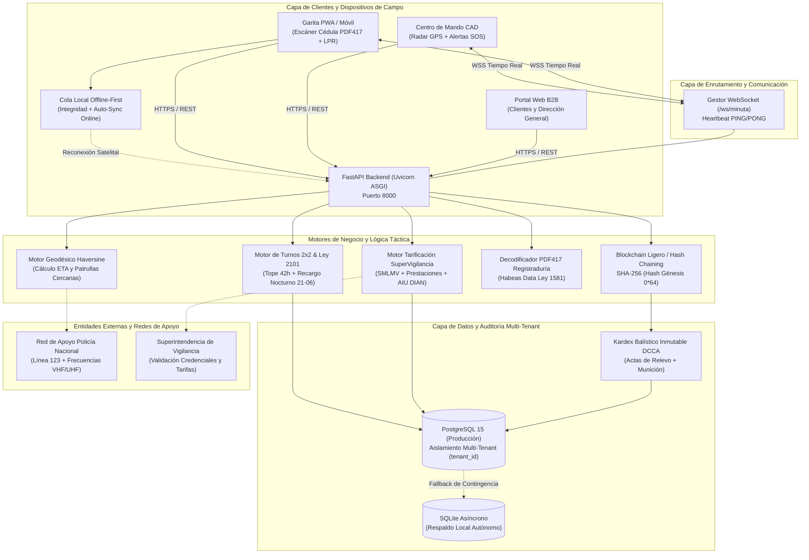

# SENTINEL // OPS (Release Enterprise V3.5) — Plataforma SaaS B2B para Empresas de Seguridad Privada en Colombia

Plataforma empresarial de nivel de producción diseñada para la administración táctica, armamento Indumil, credenciales SuperVigilancia, programación de turnos rotativos 2x2 (12h), minuta digital con visibilidad dual, alertas SOS en tiempo real, rondas QR/GPS con soporte Offline-First, tarificación legal SuperVigilancia con prefacturación B2B, control de acceso en garita con escáner PDF417 y reconocimiento óptico de placas (LPR), libro balístico digital DCCA Indumil, despacho asistido por computadora (CAD) con radar GPS, enlace a la Red de Apoyo de la Policía Nacional (PONAL) y arquitectura SaaS Multi-Tenant con encadenamiento criptográfico forense (Blockchain Ligero SHA-256).

---

## 1. Tabla de Arquitectura Técnica y Stack Tecnológico

| Capa Arquitectónica | Tecnologías y Librerías | Propósito Operativo |
| :--- | :--- | :--- |
| **Frontend Táctico (SPA/PWA)** | React 18, TypeScript 5, Vite 5, Tailwind CSS, Lucide Icons, Axios, Zustand | Consola táctica de alta densidad, modo alto contraste, PWA instalable para garita y supervisores. |
| **Optimización de Bundle** | Rollup Manual Chunks (`vendor-react`, `vendor-icons`, `vendor-utils`) | Code splitting modular con carga diferida, reduciendo tiempos de arranque en redes 3G/4G de garitas. |
| **Backend & API Gateway** | Python 3.12, FastAPI, Uvicorn (ASGI), Pydantic V2 | Endpoints REST de alto rendimiento, validación tipada estricta, documentación interactiva OpenAPI/Swagger. |
| **Tiempo Real y WebSockets** | Starlette WebSockets, `GestorMinutaWebSocket` con Heartbeat PING/PONG | Transmisión bidireccional instantánea de minutas, alertas SOS y despachos CAD con limpieza de sockets muertos. |
| **Capa de Datos y ORM** | SQLAlchemy 2.0 (Async), Asyncpg, Aiosqlite | Abstracción asíncrona de base de datos con índices compuestos en `tenant_id`, `puesto_id` y `fecha_creacion`. |
| **Base de Datos Principal** | PostgreSQL 15 (Docker) + SQLite Local (Contingencia) | Persistencia relacional multi-tenant con tolerancia a fallos y failover automático en contingencia. |
| **Criptografía y Seguridad** | Passlib, Bcrypt con salteado dinámico, PyJWT (HMAC-SHA256), Hashlib | Autenticación JWT por pestaña (`sessionStorage`), blockchain ligero SHA-256 encadenado y protección XSS/DoS. |
| **Motor Normativo Laboral** | Python ZoneInfo (`America/Bogota`), Datetime | Liquidación turno a turno con tope semanal de 42 horas (Ley 2101), recargos nocturnos y dominicales. |
| **Infraestructura y Cloud** | Docker, Docker Compose V2, Nginx, Healthchecks, GitHub Actions | Despliegue contenerizado orquestado en un solo comando y canal CI/CD automatizado. |

---

## 2. Estructura del Proyecto

Organización modular limpia con separación estricta de responsabilidades entre cliente y servidor:

```text
├── .github/
│   └── workflows/
│       └── ci.yml               # Pipeline CI (Pytest 3.12 + Typecheck/Vite Build Node 20)
├── .env.example                 # Variables de entorno críticas documentadas
├── docker-compose.yml           # Orquestación productiva de servicios (Postgres 15 + Servidor)
├── Dockerfile                   # Compilación multi-etapa (Node 20 Alpine + Python 3.12)
├── iniciar.sh                   # Script de arranque táctico portátil con rutas relativas
├── README.md                    # Documentación maestra y referencia regulatoria
├── backend/
│   ├── pyproject.toml           # Configuración de pruebas Pytest y herramientas Python
│   ├── requirements.txt         # Dependencias de producción y librerías criptográficas
│   ├── app/
│   │   ├── main.py              # Punto de entrada FastAPI, ciclo de vida y middlewares
│   │   ├── nucleo/              # Configuración BaseSettings, base de datos y seguridad JWT/Bcrypt
│   │   ├── modelos/             # Modelos declarativos SQLAlchemy con índices multi-tenant
│   │   ├── esquemas/            # Esquemas de entrada/salida y validación Pydantic V2
│   │   ├── servicios/           # Motores de turnos, tarificación, websockets, PDF417 y forense
│   │   └── rutas/               # Controladores de API REST y WebSockets modulares
│   └── tests/                   # Suite de 20 pruebas automatizadas (Pytest)
└── frontend/
    ├── package.json             # Manifiesto de paquetes y scripts de compilación
    ├── tsconfig.json            # Configuración estricta de TypeScript
    ├── vite.config.ts           # Configuración Vite con Code Splitting (manualChunks)
    ├── tailwind.config.js       # Tokens de diseño táctico militar de alto contraste
    └── src/
        ├── main.tsx             # Punto de montaje del Virtual DOM
        ├── App.tsx              # Centro de control y enrutamiento con guardia de sesión
        ├── tipos/               # Modelos de dominio e interfaces TypeScript
        ├── estado/              # Gestión de estado global con Zustand (sessionStorage)
        ├── servicios/           # Cliente HTTP Axios centralizado y WebSocket
        └── componentes/         # 12 módulos tácticos interactivos de usuario
```

---

## 3. Diagrama de Arquitectura del Sistema (Mermaid)



---

## 4. Marco Legal y Cumplimiento Regulatorio Colombiano

SENTINEL // OPS está alineado de forma nativa con el marco jurídico colombiano aplicable a las empresas prestadoras de servicios de vigilancia y seguridad privada:

1. **Superintendencia de Vigilancia y Seguridad Privada (Decreto 356 de 1994):**
   - Control estricto de credenciales de guardas y supervisores con semáforo preventivo a 30 días.
   - Bloqueo sistemático de programación y relevo a personal con credenciales o psicofísicos vencidos.
   - Generación de libros foliados digitales oficiales con sello criptográfico SHA-256 para inspecciones técnicas.

2. **Ley 2101 de 2021 (Jornada Laboral de 42 Horas Semanales):**
   - Transición dinámica automatizada: al acumular 42 horas ordinarias en la semana, las horas subsiguientes se liquidan como horas extras (diurnas al `+25%` o nocturnas al `+75%`).
   - Fragmentación de turnos nocturnos (`18:00` a `06:00`) en el corte de medianoche (`00:00:00`) para cálculo exacto de recargos nocturnos (`21:00` a `06:00`), dominicales y festivos por día calendario.
   - Descuento automático proporcional de horas por ausentismos registrados (incapacidades EPS/ARL, licencias y faltas).

3. **Ley 1920 de 2018 (Ley del Vigilante):**
   - Parametrización de turnos operativos de 12 horas con descansos mínimos obligatorios entre jornadas ($\ge 12\text{h}$).
   - Integración obligatoria de pólizas colectivas de vida y seguro de riesgos laborales nivel V en el costeo tarifario.

4. **Decreto 2535 de 1993 y Normativa DCCA (Departamento de Control Comercio de Armas):**
   - Semáforo preventivo de salvoconductos Indumil a 90, 60 y 30 días calendario de expiración.
   - Kardex balístico digital inmutable con registro foliado de munición autorizada, consumos por incidentes, reposiciones y pruebas de tiro.
   - Control de vencimiento anual (365 días) de certificados de academia y polígono de tiro reglamentario.

5. **Estatuto Tributario DIAN — Art. 462-1 (Servicios Especiales de Vigilancia y Aseo):**
   - Base gravable especial: AIU (Administración, Imprevistos y Utilidades) regulado, no menor al 10% del valor del contrato.
   - Liquidación de IVA del 19% aplicado exclusivamente sobre la porción correspondiente a la Administración.

6. **Ley Estatutaria 1581 de 2012 y Decreto 1377 de 2013 (Habeas Data):**
   - Consentimiento expreso obligatorio (`autoriza_tratamiento_datos: bool = True`) registrado en cada ingreso de visitantes y contratistas mediante escáner PDF417 de cédula en garita.
   - Enmascaramiento de números de documento y datos sensibles en logs del sistema (`10******50`).

7. **Estándares Internacionales BASC e ISO 28000:**
   - Cadena de custodia digital mediante Hash Chaining forense en actas de relevo, minutas y movimientos balísticos.
   - Trazabilidad total de accesos perimetrales y control de geocercas en rondas tácticas.

---

## 5. Módulos Operativos y Referencia Rápida de Endpoints

### 5.1. Criptografía Forense y Blockchain Ligero (SHA-256 Chaining)
- Las **Actas de Relevo con Armamento Indumil**, los registros de la **Minuta Digital** y el **Kardex Balístico DCCA** implementan encadenamiento criptográfico:
  $$\text{hash}_{\text{actual}} = \text{SHA256}(\text{payload}_{\text{actual}} \parallel \text{hash}_{\text{anterior}})$$
- Si es el primer registro del puesto, se emplea un **Hash Génesis** (`"0" * 64`). Cualquier intento de adulteración rompe la cadena, garantizando inmutabilidad forense ante auditorías de la SuperVigilancia.
- **Endpoint clave:** `GET /api/minuta/actas-relevo/{acta_id}/html` — Emisión oficial imprimible del acta de relevo foliada con código de seguridad SHA-256 y protección XSS.

### 5.2. Motor Inteligente de Turnos 2x2, Carga Masiva y Ley 2101
- Programación automatizada del ciclo rotativo de 6 días: 2 Diurnos (`06:00` a `18:00`), 2 Nocturnos (`18:00` a `06:00`) y 2 Descansos Compensatorios (24h francas).
- Sugerencia de guardas relevantes en un clic basada en puntaje de idoneidad, credencial vigente y menor acumulación de horas extras.
- Exportación en un clic de prenómina en formato `.CSV` optimizado para software contable colombiano (Siigo, Novasoft, Helisa).
- **Endpoint clave:** `POST /api/organizacion/usuarios/importar-csv` — Inserción masiva de personal con pre-cálculo único de hash `bcrypt` (`Sentinel2026*`) y validación en memoria sin bloqueo del Event Loop.

### 5.3. Control de Acceso en Garita, Escáner PDF417 y Reconocimiento LPR
- Decodificación nativa de la cédula de ciudadanía colombiana (trama PDF417 de Registraduría Nacional).
- Consentimiento de Habeas Data (Ley 1581 de 2012) integrado en el formulario de ingreso.
- **Endpoint clave:** `POST /api/acceso/escanear-placa` — Reconocimiento y normalización inmediata de placas bajo el estándar RUNT (`ABC-123` automóviles y `ABC-12D` motocicletas).

### 5.4. Centro de Despacho Táctico CAD y Monitoreo Satelital
- Radar GPS cartográfico con telemetría en vivo de puestos y supervisores motorizados.
- Algoritmo geodésico de Haversine para despacho de la patrulla más cercana con cálculo de ETA.
- **Endpoint clave:** `GET /api/cad/red-apoyo-ponal` — Directorio táctico integrado con la línea nacional 123, CAI de jurisdicción y frecuencias de radio (VHF/UHF) por puesto vigilado.

### 5.5. Auditoría Forense y Respaldo Criptográfico
- **Endpoint clave:** `GET /api/reportes/respaldo-forense-cifrado` — Volcado forense maestro que consolida turnos, minutas, actas de armamento, movimientos balísticos y facturación bajo un sello criptográfico unificado para peritajes judiciales.

### 5.6. Resiliencia Offline-First en Rondas QR/GPS
- Cola local persistente con cálculo de integridad y timestamp de captura de cliente.
- Detección automática del evento de red `online` y sincronización en segundo plano sin intervención humana.
- Indicador visual claro del estado de enlace: `ONLINE` o `MODO OFFLINE-FIRST RETENIDO`.

---

## 6. Matriz de Roles y Aislamiento Multi-Tenant

| Rol | Alcance y Permisos Operativos |
| :--- | :--- |
| **`ADMINISTRADOR`** | Acceso total a la compañía: Centro de mando, configuración salarial, excepciones de credencial, tarificación B2B, auditoría forense y gestión global de puestos. |
| **`SUPERVISOR`** | Operaciones de campo: Despacho CAD de patrullas, atención de sirenas SOS, resolución de solicitudes de intercambio, revisión de relevos y actas Indumil. |
| **`RRHH`** | Talento humano: Acreditación de credenciales SuperVigilancia, carga masiva CSV, novedades de ausentismo y exportación de prenómina Ley 2101. |
| **`OPERADOR`** | Guarda de seguridad en puesto: Control de acceso garita (PDF417 + LPR), checklist de dotación Indumil, botón de pánico SOS y rondas de control QR/GPS. |
| **`CLIENTE`** | Contratante auditado: Acceso exclusivo a los datos de su sede (`puesto_base_id`), minutas públicas y SLA de rondas. **Restringido con `403 Forbidden` ante cualquier intento de consulta fuera de su instalación.** |

---

## 7. Configuración de Variables de Entorno (`.env.example`)

Cree un archivo `.env` en la raíz del proyecto tomando como referencia `.env.example`:

```bash
cp .env.example .env
```

Variables documentadas en el archivo de entorno:

| Variable | Valor por Defecto | Descripción |
| :--- | :--- | :--- |
| `ENTORNO` | `produccion` | Entorno de despliegue (`desarrollo` / `produccion`). |
| `MODO_MULTI_TENANT` | `True` | Habilita aislamiento estricto por `tenant_id`. |
| `TENANT_ID_PREDETERMINADO` | `EMPRESA-SEGURIDAD-COLOMBIA-01` | Identificador del tenant predeterminado. |
| `CORS_ORIGINS` | `http://localhost:5173,http://localhost:8000` | Orígenes web autorizados para interactuar con la API. |
| `URL_BASE_DATOS_POSTGRES` | `postgresql+asyncpg://...` | Cadena de conexión asíncrona a PostgreSQL 15. |
| `URL_BASE_DATOS_RESPALDO` | `sqlite+aiosqlite:///./sentinel_ops_local.db` | Base de datos SQLite de contingencia local. |
| `CLAVE_SECRETA_JWT` | `sentinel_ops_clave_maestra_2026...` | Clave criptográfica para firma de tokens JWT HMAC-SHA256. |
| `SMLMV_VIGENTE` | `1423500.0` | Salario Mínimo Legal Mensual Vigente en Colombia (COP). |
| `AUXILIO_TRANSPORTE_VIGENTE` | `200000.0` | Auxilio de transporte legal vigente (COP). |
| `TOPE_HORAS_SEMANALES` | `42` | Tope semanal de jornada ordinaria según Ley 2101. |

---

## 8. Despliegue con Docker Compose (Producción Unificada)

Para levantar la base de datos PostgreSQL 15 y el servidor unificado de Sentinel OPS con un solo comando:

```bash
docker compose up -d --build
```

El stack incluye:

1. **`base_datos_sentinel`**: Contenedor PostgreSQL 15 Alpine con healthcheck nativo (`pg_isready`) y volumen persistente de datos.
2. **`servidor_sentinel`**: Contenedor de producción multi-etapa que compila el frontend en Vite y ejecuta FastAPI con Uvicorn ASGI en el puerto `8000`.

Para consultar el estado de salud de los contenedores:
```bash
docker compose ps
```

---

## 9. Ejecución en Desarrollo Local

### Opción A: Script Unificado Portátil (Recomendado)
```bash
bash iniciar.sh
```
*Detecta automáticamente entornos virtuales en `.venv/` y levanta backend (`:8000`) y frontend (`:5173`).*

### Opción B: Ejecución Manual en Terminales Separadas

#### Terminal 1 — Backend (FastAPI + Uvicorn)
```bash
# En Linux / macOS / Git Bash:
cd backend
source .venv/bin/activate  # o source .venv/Scripts/activate en Windows
python -m uvicorn app.main:aplicacion --host 127.0.0.1 --port 8000 --reload

# En Windows PowerShell:
cd backend
.\.venv\Scripts\Activate.ps1
python -m uvicorn app.main:aplicacion --host 127.0.0.1 --port 8000 --reload
```
- **API Swagger OpenAPI:** `http://127.0.0.1:8000/docs`
- **Healthcheck:** `http://127.0.0.1:8000/health`

#### Terminal 2 — Frontend (Vite + React)
```bash
cd frontend
npm run dev
```
- **Aplicación Web:** `http://localhost:5173/`

---

## 10. Cuentas Semilla del Sistema (Contraseña Maestra: `Sentinel2026*`)

| Rol | Correo Electrónico | Indicativo / Placa | Sede Asignada |
| :--- | :--- | :--- | :--- |
| **Administrador** | `admin@sentinelops.co` | `PL-001` | Todas las sedes (Global) |
| **Supervisor CAD** | `supervisor@sentinelops.co` | `SUP-101` | Patrulla Móvil / Jurisdicción Norte |
| **RRHH & Nómina** | `rrhh@sentinelops.co` | `RRH-201` | Centro de Gestión Humana |
| **Operador Garita** | `operador1@sentinelops.co` | `OPR-1001` | Puesto Torre Financiera (`PST-BOG-01`) |
| **Cliente B2B** | `cliente@sentinelops.co` | `CLI-901` | Torre Financiera (`PST-BOG-01`) |

---

## 11. Suite de Pruebas Automatizadas y Aseguramiento de Calidad

```bash
# Suite completa de Pytest (20 pruebas unitarias y de integración)
.\backend\.venv\Scripts\pytest.exe backend/tests -v

# Compilación y verificación estricta de tipado TypeScript
npm --prefix frontend run build
```

**Resultado de Pruebas Automatizadas:**
- `20 passed` en `pytest` (100% de la suite en verde).
- Compilación de producción en Vite con cero errores de TypeScript y code splitting optimizado sin advertencias de tamaño de bundle.

---

## 12. Estado del Roadmap, Cobertura Integral y Certificación V3.5

- [x] **Fases 1 a 7 — Núcleo Operativo:** Control RBAC 5 Niveles, Programación Rotativa 2x2, Minuta Digital WebSockets en tiempo real, Checklist de Dotación Indumil, Rondas de Control QR/GPS Offline-First y Liquidación Laboral con tope dinámico Ley 2101 (42 horas semanales).
- [x] **Fase 8 — Tarificación Legal SuperVigilancia & Facturación B2B:** Cálculo regulado de piso tarifario mensual por puesto (4 guardas 24/7), factor prestacional, recargo del 10% por armas, AIU $\ge 10\%$ e IVA del 19% sobre AIU (Art. 462-1 E.T. DIAN) con prefacturas foliadas.
- [x] **Fase 9 — Control de Acceso Garita & Lectura PDF417:** Decodificación nativa de la cédula de ciudadanía colombiana (Registraduría), reconocimiento óptico LPR de placas vehiculares bajo estándar RUNT (`ABC-123` y `ABC-12D`), y consentimiento expreso de Habeas Data (Ley 1581 de 2012).
- [x] **Fase 10 — Libro Balístico Digital DCCA Indumil:** Semáforo preventivo de salvoconductos (90/60/30 días), kardex balístico inmutable de munición con Blockchain Ligero SHA-256 y acreditación obligatoria de tiro anual.
- [x] **Fase 11 — Centro de Despacho CAD & Monitoreo GPS:** Radar táctico cartográfico en vivo, algoritmo geodésico Haversine para cálculo de ETA y asignación de patrullas cercanas, cronometraje de reacción en segundos y catálogo de la Red de Apoyo PONAL (123).
- [x] **Fase 12 — Arquitectura SaaS Multi-Tenant & Contenerización:** Aislamiento estricto por `tenant_id`, restricción `403 Forbidden` para cuentas cliente fuera de su instalación, volcado forense criptográfico y Dockerfile multi-etapa para producción unificada.
- [x] **Optimización Enterprise V3.5 — Rendimiento, Resiliencia y Criptografía:**
  - Carga masiva CSV optimizada (`POST /api/organizacion/usuarios/importar-csv`) con pre-cálculo único de hash `bcrypt` y validación en memoria sin bloqueo del Event Loop.
  - Blockchain Ligero / Hash Chaining SHA-256 con hash génesis (`"0" * 64`) en Actas de Relevo, Minutas y Kardex Balístico.
  - Fragmentación milimétrica por día calendario en el corte de medianoche (`00:00:00`) para turnos nocturnos (`18:00` a `06:00`).
  - Code Splitting en Vite con `manualChunks` (`vendor-react`, `vendor-icons`, `vendor-utils`), reduciendo el bundle a cero advertencias de tamaño.
  - Sincronización Offline-First resiliente con hash de integridad local y reconexión automática mediante `window.addEventListener('online')`.
  - Resiliencia en WebSockets con descarte de conexiones muertas y latidos PING/PONG.
