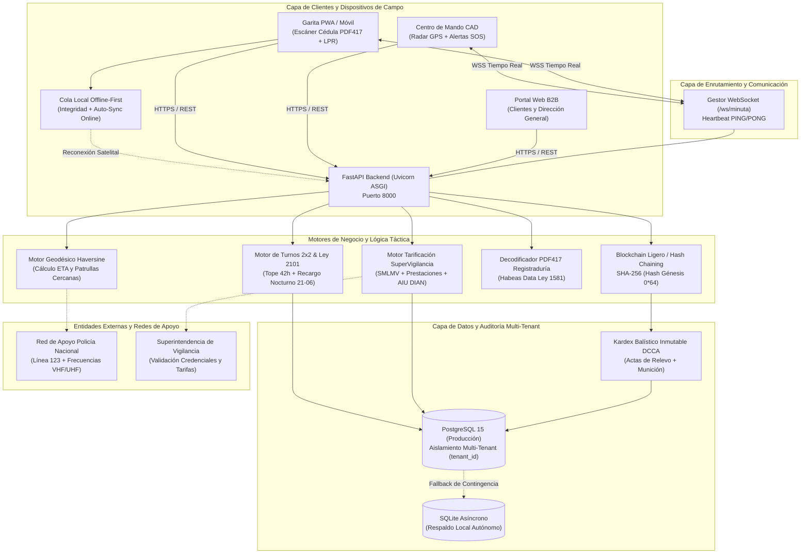

# SENTINEL // OPS (Release Enterprise V5.0) — Plataforma SaaS B2B para Empresas de Vigilancia y Seguridad Privada en Colombia

[](https://github.com/KievDxD/Sentinel-Ops/actions/workflows/ci.yml)


Plataforma empresarial de grado de producción diseñada específicamente para el sector de seguridad y vigilancia privada en Colombia. Centraliza la administración táctica de armamento Indumil, control estricto de credenciales SuperVigilancia, programación de turnos rotativos 2x2 (12 horas), minuta digital con visibilidad dual en tiempo real mediante WebSockets, alertas de pánico SOS con geolocalización, rondas QR/GPS con soporte Offline-First, tarificación legal SuperVigilancia con prefacturación B2B foliada, control de acceso perimetral en garita con decodificador de cédulas PDF417 y reconocimiento óptico de placas vehiculares (LPR), libro balístico digital DCCA Indumil, centro de despacho asistido por computadora (CAD) con radar GPS, integración directa con la Red de Apoyo de la Policía Nacional (PONAL), **Operaciones Especiales de Escolta VIP/Convoyes BASC, Biodetección Canina K9, Cumplimiento SARLAFT 2.0 (OFAC/ONU/INTERPOL/PONAL), SG-SST Decreto 1072 / Hombre Caído e Inteligencia Táctica con Laboratorio Forense Activo SHA-256**.

---

## 1. Tabla de Arquitectura Técnica y Stack Tecnológico

| Capa Arquitectónica | Tecnologías y Librerías | Propósito Operativo |
| :--- | :--- | :--- |
| **Frontend Táctico (SPA/PWA)** | React 18, TypeScript 5, Vite 5, Tailwind CSS, Lucide Icons, Axios, Zustand | Consola táctica de alta densidad, modo alto contraste, PWA instalable para garitas y supervisores de campo. |
| **Optimización de Bundle** | Rollup Manual Chunks (`vendor-react`, `vendor-icons`, `vendor-utils`) | Code splitting modular con carga diferida, eliminando bloqueos de carga inicial en redes celulares (3G/4G). |
| **Backend & API Gateway** | Python 3.12 / 3.15, FastAPI, Uvicorn (ASGI), Pydantic V2 | Endpoints REST asíncronos de alto rendimiento, validación estricta y documentación interactiva OpenAPI/Swagger. |
| **Tiempo Real y WebSockets** | Starlette WebSockets, `GestorMinutaWebSocket` con Heartbeat PING/PONG | Transmisión bidireccional inmediata de minutas, alertas de pánico SOS y eventos CAD con depuración de conexiones caídas. |
| **Capa de Datos y ORM** | SQLAlchemy 2.0 (Async), Asyncpg, Aiosqlite | Acceso a datos con soporte de transacciones asíncronas e índices compuestos en `tenant_id`, `puesto_id` y marcas temporales. |
| **Persistencia Principal y Contingencia** | PostgreSQL 15 (Docker) + SQLite Local Autónomo | Persistencia multi-tenant con aislamiento estricto y conmutación automática por fallo hacia base local en contingencia. |
| **Criptografía y Seguridad** | Passlib, Bcrypt dinámico, PyJWT (HMAC-SHA256), Hashlib SHA-256 | Tokens JWT por pestaña (`sessionStorage`), blockchain ligero SHA-256 encadenado y sanitización contra XSS e inyecciones. |
| **Motor Normativo Laboral** | Python ZoneInfo (`America/Bogota`), Datetime | Liquidación turno a turno con tope semanal de 42 horas (Ley 2101), recargos nocturnos (21:00-06:00) y dominicales. |
| **Integración CI/CD y Despliegue** | Docker, Docker Compose V2, GitHub Actions, Nginx | Pipeline automatizado de pruebas y compilación en cada push, con empaquetado multi-etapa contenerizado. |

---

## 2. Estructura del Proyecto

Organización modular limpia con desacoplamiento absoluto entre backend, frontend y automatización de despliegue:

```text
├── .github/
│   └── workflows/
│       └── ci.yml               # Pipeline CI (Pytest 3.12 + Typecheck/Vite Build Node 20)
├── .env.example                 # Plantilla de variables de entorno críticas
├── docker-compose.yml           # Orquestación de producción (PostgreSQL 15 + Servidor Unificado)
├── Dockerfile                   # Compilación multi-etapa (Node 20 Alpine + Python 3.12)
├── iniciar.sh                   # Script táctico portátil de arranque en desarrollo local
├── CODEBASE_SCHEMA.md           # Esquema canónico de rutas, modelos y firmas exportadas
├── README.md                    # Documentación maestra y referencia regulatoria
├── backend/
│   ├── pyproject.toml           # Configuración de herramientas y suite Pytest
│   ├── requirements.txt         # Dependencias de producción y librerías criptográficas
│   ├── app/
│   │   ├── main.py              # Punto de entrada FastAPI, ciclo de vida y middlewares
│   │   ├── nucleo/              # Configuración BaseSettings, base de datos y seguridad JWT/Bcrypt
│   │   ├── modelos/             # Modelos declarativos SQLAlchemy con índices multi-tenant
│   │   ├── esquemas/            # Esquemas de entrada/salida y validación Pydantic V2
│   │   ├── servicios/           # Motores de turnos, tarificación, websockets, PDF417, simulador V4/V5 y forense
│   │   └── rutas/               # Controladores de API REST y WebSockets modulares (13 enrutadores)
│   └── tests/                   # Suite de 34 pruebas automatizadas (Pytest)
└── frontend/
    ├── package.json             # Manifiesto de dependencias y scripts de compilación
    ├── tsconfig.json            # Configuración estricta de compilación TypeScript
    ├── vite.config.ts           # Configuración Vite con Code Splitting (manualChunks)
    ├── tailwind.config.js       # Tokens de diseño táctico militar de alto contraste
    ├── public/
    │   └── manifest.json        # Manifiesto PWA para instalación en garitas y móviles
    └── src/
        ├── main.tsx             # Punto de montaje del Virtual DOM
        ├── App.tsx              # Centro de control táctico y guardia de sesión
        ├── tipos/               # Modelos de dominio e interfaces TypeScript
        ├── estado/              # Gestión de estado global con Zustand (sessionStorage por pestaña)
        ├── servicios/           # Cliente HTTP Axios centralizado y WebSocket
        └── componentes/         # 15 módulos tácticos interactivos de usuario
```

---

## 3. Diagrama de Arquitectura del Sistema (Mermaid)



---

## 4. Marco Legal y Cumplimiento Regulatorio Colombiano

SENTINEL // OPS está alineado de forma nativa con el marco jurídico colombiano aplicable a las empresas prestadoras de servicios de vigilancia y seguridad privada:

1. **Superintendencia de Vigilancia y Seguridad Privada (Decreto 356 de 1994):**
   - Control riguroso de credenciales de guardas y supervisores con semáforo preventivo a 30 días (`VIGENTE`, `POR_VENCER`, `VENCIDA`).
   - Bloqueo sistemático de programación y relevo a personal con credenciales o certificados psicofísicos vencidos (con excepción explícita auditable).
   - Generación de libros foliados digitales oficiales con sello criptográfico SHA-256 para inspecciones técnicas de la SuperVigilancia.

2. **Ley 2101 de 2021 (Jornada Laboral de 42 Horas Semanales):**
   - Transición dinámica automatizada: al acumular 42 horas ordinarias en la semana, las horas subsiguientes se liquidan como horas extras (diurnas al `+25%` o nocturnas al `+75%`).
   - Fragmentación de turnos nocturnos (`18:00` a `06:00`) en el corte de medianoche (`00:00:00`) para cálculo exacto de recargos nocturnos (`21:00` a `06:00`), dominicales y festivos por día calendario.
   - Descuento automático proporcional de horas por ausentismos registrados (incapacidades EPS/ARL, licencias remuneradas y faltas injustificadas).

3. **Ley 1920 de 2018 (Ley del Vigilante):**
   - Parametrización de turnos operativos de 12 horas con descansos mínimos obligatorios entre jornadas ($\ge 12\text{h}$).
   - Integración obligatoria de pólizas colectivas de seguro de vida y riesgos laborales nivel V (ARL) en el costeo tarifario.

4. **Decreto 2535 de 1993 y Normativa DCCA (Departamento de Control Comercio de Armas - Indumil):**
   - Semáforo preventivo de salvoconductos Indumil a 90, 60 y 30 días calendario de expiración.
   - Kardex balístico digital inmutable con registro foliado de munición autorizada, consumos por incidentes, reposiciones y pruebas de polígono.
   - Control de vencimiento anual (365 días) de certificados de academia y polígono de tiro reglamentario.

5. **Estatuto Tributario DIAN — Art. 462-1 (Servicios Especiales de Vigilancia y Aseo):**
   - Base gravable especial: AIU (Administración, Imprevistos y Utilidades) regulado, no menor al 10% del valor del contrato.
   - Liquidación de IVA del 19% aplicado exclusivamente sobre la porción correspondiente a la Administración.

6. **Ley Estatutaria 1581 de 2012 y Decreto 1377 de 2013 (Habeas Data):**
   - Consentimiento expreso obligatorio (`autoriza_tratamiento_datos: bool = True`) registrado en cada ingreso de visitantes y contratistas mediante escáner PDF417 de cédula en garita.
   - Enmascaramiento de números de documento y datos sensibles en logs del sistema (`10******50`).

7. **Estándares Internacionales BASC e ISO 28000:**
   - Cadena de custodia digital mediante Hash Chaining forense en actas de relevo, minutas, manifiestos de escolta BASC y movimientos balísticos.
   - Trazabilidad total de accesos perimetrales, verificación de corredores viales y control de geocercas en rondas tácticas.

8. **SARLAFT 2.0 y SG-SST (Circular Externa SuperVigilancia / Decreto 1072 de 2015):**
   - Cruce instantáneo de listas restrictivas (OFAC/Clinton, ONU, INTERPOL, Antecedentes PONAL, Procuraduría y Contraloría) con emisión de Certificado SHA-256.
   - Validación psicofísica pre-turno ARL Nivel V (sueño mínimo, cero alcohol y EPP), semáforo de vida útil de paneles balísticos Kevlar (5 años) y monitor de supervivencia "Hombre Caído" (*Dead Man's Switch*).

---

## 5. Módulos Operativos y Referencia de la API REST

### 5.1. Autenticación y Gestión Organizacional (`/api/autenticacion`, `/api/organizacion`)
- `POST /api/autenticacion/iniciar-sesion`: Emisión de par de tokens JWT (`token_acceso` y `token_refresco`) con claims de rol y tenant.
- `POST /api/autenticacion/registro-real`: Registro de nuevos usuarios con rol operativo o de supervisión.
- `POST /api/autenticacion/refrescar-token`: Renovación transparente de sesión sin desloguear al operador en turno.
- `GET /api/autenticacion/perfil`: Datos del usuario autenticado actual.
- `GET /api/organizacion/usuarios`: Listado de guardas, supervisores y personal administrativo.
- `POST /api/organizacion/usuarios`: Alta manual de usuario con perfil militar y dotación inicial.
- `POST /api/organizacion/usuarios/importar-csv`: Inserción masiva de personal con pre-cálculo único de hash `bcrypt` (`Sentinel2026*`) y validación en memoria sin bloqueo del Event Loop.
- `PUT /api/organizacion/usuarios/{usuario_id}/credencial`: Actualización de vigencias de carné SuperVigilancia y examen psicofísico.
- `PUT /api/organizacion/usuarios/{usuario_id}/asignar-puesto`: Vinculación o desvinculación de un operador a su sede base.
- `GET /api/organizacion/puestos`: Directorio de puestos de vigilancia con coordenadas geográficas y geocercas.
- `POST /api/organizacion/puestos`: Creación y configuración de nuevos puestos físicos de seguridad.

### 5.2. Motor Inteligente de Turnos 2x2 y Ausentismos (`/api/turnos`)
- `GET /api/turnos`: Listado de turnos programados con liquidación laboral discriminada por recargos.
- `POST /api/turnos/generar-rotacion-2x2`: Programación del ciclo rotativo de 6 días (2 Diurnos, 2 Nocturnos, 2 Francos) para un operador.
- `POST /api/turnos/generar-cobertura-puesto-2x2`: Cuadrícula completa de cobertura continua 24/7 para un puesto con escuadrón de 4 operadores.
- `GET /api/turnos/ausentismos`: Registro de novedades de ausentismo con impacto en nómina.
- `POST /api/turnos/ausentismos`: Alta de incapacidad EPS/ARL, licencia o falta injustificada con recálculo de horas.
- `GET /api/turnos/{turno_id}/sugerir-relevantes`: Sugerencia inteligente de relevos basada en credencial vigente y menor acumulación de horas extras.
- `POST /api/turnos/{turno_id}/asignar-relevante`: Asignación del guarda de cobertura al turno descubierto.

### 5.3. Minuta Digital, Actas de Relevo y Sirena SOS (`/api/minuta`, `/ws/minuta`)
- `GET /api/minuta`: Consulta paginada y filtrada de anotaciones con visibilidad dual (`PUBLICA_CLIENTE` o `INTERNA_OPERATIVA`).
- `POST /api/minuta`: Registro de eventos en garita con hash encadenado SHA-256 y difusión instantánea por WebSocket.
- `GET /api/minuta/dotacion-puesto/{puesto_id}`: Consulta de armamento, chaleco, salvoconducto y radio asignados a la garita.
- `GET /api/minuta/actas-relevo`: Historial de entregas y recibos de puesto con inventario físico verificado.
- `POST /api/minuta/actas-relevo`: Acta formal de cambio de turno con firma digital encadenada.
- `GET /api/minuta/actas-relevo/{acta_id}/html`: Acta oficial foliada imprimible con código de verificación SHA-256.
- `GET /api/minuta/alertas-sos`: Listado de alarmas de pánico activas o atendidas en tiempo real.
- `POST /api/minuta/alertas-sos`: Disparo inmediato de alarma de pánico con telemetría GPS del dispositivo.
- `PUT /api/minuta/alertas-sos/{alerta_id}/atender`: Cierre y registro de tiempo de respuesta de la patrulla de apoyo.
- `WebSocket /ws/minuta`: Canal bidireccional en tiempo real para eventos de garita y alarmas SOS con latido PING/PONG.

### 5.4. Solicitudes de Intercambio de Turnos (`/api/intercambios`)
- `GET /api/intercambios`: Tablero de solicitudes de intercambio entre guardas.
- `POST /api/intercambios`: Creación de solicitud con validación matemática previa de no-solapamiento y descanso mínimo ($\ge 12\text{h}$).
- `PUT /api/intercambios/{intercambio_id}/resolver`: Aprobación o rechazo por parte del supervisor de zona.

### 5.5. Rondas de Control QR/GPS con Soporte Offline-First (`/api/rondas`)
- `GET /api/rondas/puntos-control`: Puntos tácticos georreferenciados con tolerancia de radio en metros.
- `GET /api/rondas/marcaciones`: Trazabilidad de escaneos QR realizados por los guardas en ronda.
- `POST /api/rondas/marcaciones`: Registro de marcación individual con validación de geocerca geodésica (Haversine).
- `POST /api/rondas/sincronizar-offline`: Sincronización en lote de marcaciones retenidas en la cola local durante pérdidas de cobertura celular.
- `GET /api/rondas/auditoria-cobertura`: Auditoría preventiva de puestos con riesgo de abandono o descubiertos.

### 5.6. Reportes Oficiales, Prenómina, KPIs en Tiempo Real y Respaldo Forense (`/api/reportes`)
- `GET /api/reportes/prenomina-colombia-csv`: Exportación de prenómina en CSV con codificación UTF-8 con BOM compatible con Siigo, Novasoft y Helisa (exclusivo `ADMINISTRADOR` y `RRHH`).
- `GET /api/reportes/minuta-foliada-oficial`: Libro foliado oficial en HTML imprimible con sello de auditoría de custodia criptográfica SHA-256.
- `GET /api/reportes/respaldo-forense-cifrado`: Volcado maestro de auditoría forense que consolida turnos, minutas, relevos, balística y facturación bajo una firma SHA-256 integral (exclusivo `ADMINISTRADOR`).
- `GET /api/reportes/kpis-tiempo-real`: Analítica ejecutiva en vivo con `% SLA de Rondas por puesto`, `Costo Acumulado de Nómina vs Horas Extras Ley 2101`, `Tiempo Promedio de Reacción CAD (segundos)` y auditoría criptográfica en caliente del 100% de los bloques SHA-256 (`INTEGRIDAD_VERIFICADA: True`).

### 5.7. Tarificación B2B y Prefacturación Legal SuperVigilancia (`/api/facturacion`)
- `POST /api/facturacion/cotizar-tarifa`: Simulador dinámico de piso tarifario con desglose de 4 guardas, factor prestacional, recargo de armas, AIU e IVA sobre AIU (Art. 462-1 E.T.).
- `GET /api/facturacion/prefacturas`: Consulta de prefacturas comerciales emitidas y en borrador.
- `POST /api/facturacion/prefacturas`: Generación formal de prefactura con firma digital SHA-256.
- `GET /api/facturacion/prefacturas/{prefactura_id}/html`: Documento de cobro oficial B2B formateado e imprimible.

### 5.8. Control de Acceso Perimetral, Cédulas PDF417 y Reconocimiento LPR (`/api/acceso`)
- `POST /api/acceso/decodificar-cedula`: Extracción inmediata de número de documento, nombres, apellidos, fecha de nacimiento y tipo de sangre RH desde el código de barras PDF417 de la cédula colombiana.
- `POST /api/acceso/escanear-placa`: Normalización y verificación de placas vehiculares bajo estándar RUNT (`ABC-123` automóviles y `ABC-12D` motocicletas).
- `POST /api/acceso/ingreso`: Registro de ingreso perimetral con consentimiento expreso de Habeas Data (Ley 1581 de 2012).
- `PUT /api/acceso/{acceso_id}/salida`: Registro formal de salida de visitantes o contratistas.
- `GET /api/acceso/activos/{puesto_id}`: Censo en tiempo real de personas y vehículos dentro de las instalaciones.
- `GET /api/acceso/historial`: Consulta histórica de ingresos y salidas con filtros de seguridad.

### 5.9. Libro Balístico Digital DCCA Indumil (`/api/balistica`)
- `GET /api/balistica/salvoconductos-semaforo`: Semáforo preventivo de vencimiento de permisos de porte y tenencia Indumil (90, 60 y 30 días).
- `GET /api/balistica/kardex/{puesto_id}`: Historial inmutable de movimientos de munición y armamento por puesto.
- `POST /api/balistica/kardex`: Asiento foliado de dotación, consumo en incidente, polígono o mantenimiento con Blockchain Ligero SHA-256.
- `GET /api/balistica/certificados-poligono`: Control de certificados anuales de tiro de la academia de seguridad.
- `POST /api/balistica/certificados-poligono`: Registro y acreditación de práctica de polígono reglamentaria.

### 5.10. Centro de Despacho Táctico CAD, Simulación Viva y Red de Apoyo PONAL (`/api/cad`)
- `GET /api/cad/telemetria-mapa`: Consolidado cartográfico de los 6 puestos de vigilancia (Bogotá D.C. y Sabana de Occidente) y 4 patrullas motorizadas activas.
- `GET /api/cad/sugerir-patrulla/{alerta_sos_id}`: Cálculo de proximidad geodésica (Haversine) y estimación de tiempo de arribo (ETA) del supervisor más cercano.
- `POST /api/cad/despachar`: Asignación formal de la patrulla motorizada con notificación inmediata al CAD.
- `PATCH /api/cad/despacho/{despacho_id}/llegada`: Confirmación satelital de arribo de la patrulla al puesto de emergencia.
- `PATCH /api/cad/despacho/{despacho_id}/finalizar`: Cierre de la novedad con informe táctico y cronometraje de tiempo total de reacción.
- `GET /api/cad/red-apoyo-ponal`: Directorio táctico integrado con línea nacional de emergencias 123, CAI de policía por cuadrante y canales de radio VHF/UHF.
- `POST /api/cad/simular-rafaga-operativa`: Inyección atómica bajo demanda de eventos tácticos encadenados con SHA-256 (ingreso vehicular LPR en garita + marcación de ronda QR/GPS con Haversine + anotación de minuta en vivo por WebSocket + avance de patrullas CAD).
- `POST /api/cad/simulacion-viva/alternar`: Activación/desactivación del bucle asíncrono en segundo plano de telemetría GPS de patrullas motorizadas.

### 5.11. Operaciones Especiales: Escoltas VIP BASC, Biodetección K9 y Medios Tecnológicos (`/api/operaciones-especiales`)
- `GET /api/operaciones-especiales/escoltas`: Lista misiones activas e históricas de escolta de carga crítica BASC y protección VIP (`NIVEL_IIIA`, `NIVEL_IV`, `NIVEL_V`), arma Indumil asignada y manifiesto SHA-256.
- `POST /api/operaciones-especiales/escoltas`: Crea un nuevo despacho de escolta vehicular con cálculo de distancia Haversine y sello SHA-256 encadenado.
- `POST /api/operaciones-especiales/escoltas/{mision_id}/verificar-corredor`: Evalúa las coordenadas actuales frente al corredor vial autorizado; si supera el umbral en metros, dispara alerta crítica al CAD y a la Minuta WebSocket.
- `GET /api/operaciones-especiales/binomios-k9`: Unidades caninas biodetectoras (`Thor`, `Athena`, `Rex`, `Sombra`) con microchip ISO, vacunas ICA y semáforo normativo de fatiga (tope legal de 6 horas continuas).
- `POST /api/operaciones-especiales/binomios-k9/{k9_id}/registrar-descanso`: Registra descanso obligatorio en canil e hidratación veterinaria, reiniciando el contador de fatiga a `0.0h`.
- `GET /api/operaciones-especiales/medios-tecnologicos`: Salud operativa de cámaras IP LPR, NVR, radares, drones autónomos y cercas eléctricas perimetrales (voltaje en kV y latencia ms).

### 5.12. Cumplimiento Normativo SARLAFT 2.0 y SG-SST Decreto 1072 (`/api/cumplimiento`)
- `POST /api/cumplimiento/sarlaft/consultar`: Cruce instantáneo contra listas restrictivas (OFAC/Clinton, ONU, INTERPOL, Antecedentes PONAL, Procuraduría y Contraloría), clasificando en `SIN_COINCIDENCIAS`, `RIESGO_MEDIO_PEP` o `BLOQUEO_LISTA_RESTRICTIVA` y emitiendo Certificado SARLAFT con hash SHA-256.
- `GET /api/cumplimiento/sarlaft/historial`: Historial auditable de certificados SARLAFT emitidos.
- `GET /api/cumplimiento/sst/chalecos-kevlar`: Semáforo de vida útil de 5 años para paneles balísticos Kevlar (Nivel IIIA) por puesto.
- `POST /api/cumplimiento/sst/check-aptitud`: Validación psicofísica pre-turno (Decreto 1072 / ARL Nivel V) que bloquea la entrega de armamento si el guarda reporta menos de 5 horas de sueño o fatiga.
- `GET /api/cumplimiento/sst/hombre-caido`: Temporizadores de supervivencia "Hombre Caído" (*Dead Man's Switch*) en puestos nocturnos.
- `POST /api/cumplimiento/sst/hombre-caido/{puesto_id}/latido`: Confirma el pulso de vida del guarda o activa pre-alerta silenciosa SOS por inactividad.

### 5.13. Inteligencia Táctica y Laboratorio Forense Activo SHA-256 (`/api/inteligencia`)
- `GET /api/inteligencia/boletin-relevo/{puesto_id}`: Generador de Boletín Táctico de Relevo (*Shift Handover Briefing*) de las últimas 12 horas con nivel de amenaza (`BAJO`, `MODERADO`, `ALTO`, `CRITICO`), hallazgos clave, placas RUNT recurrentes y estado de dotación.
- `GET /api/inteligencia/auditoria-antifraude-rondas`: Cruza marcas de tiempo y coordenadas Haversine de rondas QR/GPS para detectar anomalías como velocidad humana imposible (`> 50 km/h` a pie) o desvíos de geocerca.
- `POST /api/inteligencia/forense/simular-sabotaje` (Exclusivo `ADMINISTRADOR`): Altera intencionalmente un bloque histórico de Minuta en BD para demostrar la detección instantánea de rotura de cadena (`INTEGRIDAD_VERIFICADA: False`, `bloque_corrupto_id`, `hash_esperado` vs `hash_calculado`).
- `POST /api/inteligencia/forense/reparar-cadena` (Exclusivo `ADMINISTRADOR`): Restaura el contenido original desde el respaldo forense y re-verifica el 100% de los eslabones SHA-256 (`INTEGRIDAD_VERIFICADA: True`).

---

## 6. Matriz de Roles y Aislamiento Multi-Tenant

| Rol | Alcance y Permisos Operativos |
| :--- | :--- |
| **`ADMINISTRADOR`** | Acceso total a la compañía: Centro de mando, configuración salarial, excepciones de credencial, tarificación B2B, auditoría forense y gestión global de puestos. |
| **`SUPERVISOR`** | Operaciones de campo: Despacho CAD de patrullas, atención de sirenas SOS, resolución de solicitudes de intercambio, revisión de relevos y actas Indumil. |
| **`RRHH`** | Talento humano: Acreditación de credenciales SuperVigilancia, carga masiva CSV, novedades de ausentismo y exportación de prenómina Ley 2101. |
| **`OPERADOR`** | Guarda de seguridad en puesto: Control de acceso en garita (PDF417 + LPR), checklist de dotación Indumil, botón de pánico SOS y rondas de control QR/GPS. |
| **`CLIENTE`** | Contratante auditado: Acceso exclusivo a los datos de su sede (`puesto_base_id`), minutas públicas y SLA de rondas. **Restringido con `403 Forbidden` ante cualquier intento de consulta fuera de su instalación.** |

---

## 7. Configuración de Variables de Entorno (`.env.example`)

Cree un archivo `.env` en la raíz del proyecto tomando como referencia `.env.example`:

```bash
cp .env.example .env
```

Variables documentadas en el archivo de entorno:

| Variable | Valor por Defecto | Descripción |
| :--- | :--- | :--- |
| `ENTORNO` | `produccion` | Entorno de ejecución (`desarrollo` / `produccion` / `test`). |
| `MODO_MULTI_TENANT` | `True` | Habilita aislamiento estricto por `tenant_id` en todas las consultas. |
| `TENANT_ID_PREDETERMINADO` | `EMPRESA-SEGURIDAD-COLOMBIA-01` | Identificador del inquilino predeterminado del sistema. |
| `CORS_ORIGINS` | `http://localhost:5173,http://localhost:8000` | Orígenes web autorizados para interactuar con la API REST y WebSockets. |
| `URL_BASE_DATOS_POSTGRES` | `postgresql+asyncpg://...` | Cadena de conexión asíncrona a PostgreSQL 15. |
| `URL_BASE_DATOS_RESPALDO` | `sqlite+aiosqlite:///./sentinel_ops_local.db` | Base de datos SQLite de contingencia local autónoma. |
| `CLAVE_SECRETA_JWT` | `sentinel_ops_clave_maestra_2026...` | Clave criptográfica para firma de tokens JWT HMAC-SHA256. |
| `SMLMV_VIGENTE` | `1423500.0` | Salario Mínimo Legal Mensual Vigente en Colombia (COP). |
| `AUXILIO_TRANSPORTE_VIGENTE` | `200000.0` | Auxilio legal de transporte mensual vigente en Colombia (COP). |
| `TOPE_HORAS_SEMANALES` | `42` | Tope semanal de jornada laboral ordinaria según Ley 2101. |

---

## 8. Despliegue con Docker Compose (Producción Unificada)

Para levantar la base de datos PostgreSQL 15 y el servidor unificado de Sentinel OPS con un solo comando:

```bash
docker compose up -d --build
```

El stack incluye:

1. **`base_datos_sentinel`**: Contenedor PostgreSQL 15 Alpine con healthcheck nativo (`pg_isready`) y volumen persistente de datos.
2. **`servidor_sentinel`**: Contenedor de producción multi-etapa que compila el frontend en Vite y ejecuta FastAPI con Uvicorn ASGI en el puerto `8000`.

Para consultar el estado de salud de los contenedores:
```bash
docker compose ps
```

Para consultar los registros en tiempo real:
```bash
docker compose logs -f servidor_sentinel
```

---

## 9. Ejecución en Desarrollo Local

### Opción A: Script Unificado Portátil (Recomendado)
```bash
bash iniciar.sh
```
*Detecta automáticamente entornos virtuales en `.venv/` o `backend/.venv/` y levanta backend (`:8000`) y frontend (`:5173`).*

### Opción B: Ejecución Manual en Terminales Separadas

#### Terminal 1 — Backend (FastAPI + Uvicorn)
```bash
# En Linux / macOS / Git Bash:
cd backend
source .venv/bin/activate
uvicorn app.main:aplicacion --host 127.0.0.1 --port 8000 --reload

# En Windows PowerShell:
cd backend
.\.venv\Scripts\Activate.ps1
python -m uvicorn app.main:aplicacion --host 127.0.0.1 --port 8000 --reload
```
- **Documentación Swagger OpenAPI:** `http://127.0.0.1:8000/docs`
- **Documentación Redoc:** `http://127.0.0.1:8000/redoc`
- **Healthcheck:** `http://127.0.0.1:8000/health`
- **Estado del Sistema:** `http://127.0.0.1:8000/api/estado`

#### Terminal 2 — Frontend (Vite + React)
```bash
cd frontend
npm install
npm run dev
```
- **Aplicación Web:** `http://localhost:5173/`

---

## 10. Cuentas Semilla del Sistema (Contraseña Maestra: `Sentinel2026*`)

Todas las cuentas precargadas en los datos semilla comparten la clave de acceso `Sentinel2026*`:

| Rol | Correo Electrónico | Indicativo / Placa | Sede Asignada |
| :--- | :--- | :--- | :--- |
| **Administrador** | `admin@sentinelops.co` | `PL-001` | Todas las sedes (Acceso Global) |
| **Supervisor CAD** | `supervisor@sentinelops.co` | `SUP-101` | Patrulla Móvil / Jurisdicción Norte |
| **RRHH & Nómina** | `rrhh@sentinelops.co` | `RRH-201` | Centro de Gestión Humana |
| **Operador Garita** | `operador1@sentinelops.co` | `OPR-1001` | Puesto Torre Financiera (`PST-BOG-01`) |
| **Cliente B2B** | `cliente@sentinelops.co` | `CLI-901` | Torre Financiera (`PST-BOG-01`) |

---

## 11. Suite de Pruebas Automatizadas y CI/CD (GitHub Actions)

El proyecto cuenta con un flujo de integración continua en [`.github/workflows/ci.yml`](.github/workflows/ci.yml) que valida de forma autónoma en cada pull request y push a la rama `main`:

```bash
# Ejecución de la suite completa de pruebas (34 pruebas unitarias y de integración)
pytest backend/tests -v

# En Windows PowerShell con el entorno virtual del backend:
backend\.venv\Scripts\python.exe -m pytest backend/tests -v

# Compilación y verificación estricta de tipado TypeScript
npm --prefix frontend run build
```

### Resumen de la Suite Automatizada (`34/34 passed`):
- `test_liquidacion_turno_diurno_12_horas`: Liquidación de turnos diurnos de 12 horas bajo jornada estándar.
- `test_liquidacion_turno_nocturno_12_horas`: Cálculo de recargos nocturnos (21:00 a 06:00) y extras.
- `test_tope_semanal_dinamico_42_horas_ley_2101`: Transición exacta al acumular 42 horas ordinarias.
- `test_descuento_automatico_por_ausentismo`: Reducción proporcional de costos por novedades médicas o faltas.
- `test_bloqueo_y_excepcion_credencial_supervigilancia`: Validación de semáforo de credenciales y bypass auditado.
- `test_distancia_geodesica_haversine_geocerca`: Precisión milimétrica del algoritmo de geocercas en rondas.
- `test_calculo_costo_guarda_incluye_prestaciones_y_seguridad_social`: Cómputo legal de cesantías, prima, vacaciones y ARL Nivel V.
- `test_puesto_24h_requiere_4_guardas_y_recargo_armas`: Regla técnica de escuadrón 24/7 y recargo del 10% por armas Indumil.
- `test_puesto_sin_arma_costo_armamento_cero`: Verificación de tarifa limpia para vigilancia no armada.
- `test_firma_digital_prefactura_sha256_consistente`: Inmutabilidad de sellos criptográficos en prefacturación B2B.
- `test_decodificador_cedula_colombiana_formato_estandar`: Decodificación de trama cruda PDF417 de la Registraduría.
- `test_decodificador_cedula_trama_invalida_o_corta`: Manejo robusto de excepciones ante lecturas incompletas.
- `test_calculo_distancia_haversine_entre_puntos_bogota`: Asignación geodésica del cuadrante de patrullas en Bogotá.
- `test_semaforo_dias_salvoconducto_calculo`: Clasificación automática de salvoconductos Indumil por vencer.
- `test_normalizacion_placa_lpr_colombiana`: Validación y corrección de placas estándar RUNT (`ABC-123` y `ABC-12D`).
- `test_parsing_carga_masiva_csv_usuarios`: Inserción rápida de personal por CSV con validación de duplicados.
- `test_integridad_cadena_sha256_hash_chaining`: Detección instantánea de rotura de cadena en actas y minutas.
- `test_fragmentacion_turno_nocturno_por_dia_calendario`: Corte exacto a medianoche (`00:00:00`) para discriminación dominical/festiva.
- `test_corte_exacto_ley_2101_tope_42_horas`: Liquidación estricta al superar el límite semanal legal.
- `test_habeas_data_enmascaramiento_y_formulario`: Cumplimiento de Ley 1581 en logs y formularios de garita.
- `test_seeder_multisede_bogota_sabana_integridad_completa`: Verifica los 6 puestos tácticos en Bogotá y Sabana de Occidente, 31+ usuarios, escuadrones 2x2 y cadena SHA-256 desde el génesis (`"0" * 64`).
- `test_simulador_rafaga_operativa_mantiene_integridad_sha256`: Valida que la inyección de ráfagas operativas mantenga la integridad criptográfica SHA-256.
- `test_kpis_tiempo_real_calculo_sla_y_auditoria_bloques`: Verifica el cálculo en vivo de SLA por sede, nómina Ley 2101, reacción CAD y auditoría de bloques SHA-256.
- `test_alternar_modo_simulacion_viva_y_telemetria_patrullas`: Valida el encendido/apagado del motor de simulación viva y el avance satelital de las 4 patrullas CAD.
- `test_coordenadas_georreferenciadas_6_puestos_bogota_sabana`: Comprueba las coordenadas georreferenciadas de las 6 sedes (`PST-BOG-01` a `PST-BOG-06`).
- `test_credenciales_vencidas_y_por_vencer_en_seeder_v4`: Verifica la distribución del semáforo SuperVigilancia (`VIGENTE`, `POR_VENCER` y 2 guardas `VENCIDA`).
- `test_creacion_y_verificacion_corredor_escolta_basc`: Valida la creación de manifiestos de escolta BASC SHA-256 y la detección de desvíos de ruta Haversine.
- `test_control_fatiga_y_descanso_unidad_canina_k9`: Comprueba el semáforo normativo de fatiga K9 (tope 6h continuas) y el reinicio tras descanso en canil.
- `test_monitoreo_medios_tecnologicos_y_cercas_por_puesto`: Verifica la telemetría de los 18 dispositivos electrónicos y cercas perimetrales en kV.
- `test_consulta_sarlaft_listas_restrictivas_y_certificado_sha256`: Valida el cruce SARLAFT 2.0 (Limpio, PEP y Bloqueo OFAC/INTERPOL) con certificado SHA-256.
- `test_sst_check_aptitud_psicofisica_y_semaforo_kevlar`: Verifica el bloqueo SG-SST Decreto 1072 ante sueño insuficiente (`< 5h`) y el semáforo de chalecos Kevlar (5 años).
- `test_alerta_hombre_caido_latido_supervivencia`: Comprueba la confirmación de pulso de vida y el disparo de pre-alerta de Hombre Caído (*Dead Man's Switch*).
- `test_boletin_relevo_inteligencia_tactica_y_antifraude_rondas`: Valida el generador de Boletín de Relevo IA por puesto y el auditor antifraude de rondas GPS/QR.
- `test_laboratorio_sabotaje_deteccion_y_autoreparacion_sha256`: Verifica el ciclo completo de sabotaje en BD, detección de eslabón corrupto SHA-256 y auto-reparación forense.

---

## 12. Estado del Roadmap, Cobertura Integral y Certificación V5.0

- [x] **Fases 1 a 7 — Núcleo Operativo:** Control RBAC 5 Niveles, Programación Rotativa 2x2, Minuta Digital WebSockets en tiempo real, Checklist de Dotación Indumil, Rondas de Control QR/GPS Offline-First y Liquidación Laboral con tope dinámico Ley 2101 (42 horas semanales).
- [x] **Fase 8 — Tarificación Legal SuperVigilancia & Facturación B2B:** Cálculo regulado de piso tarifario mensual por puesto (4 guardas 24/7), factor prestacional, recargo del 10% por armas, AIU $\ge 10\%$ e IVA del 19% sobre AIU (Art. 462-1 E.T. DIAN) con prefacturas foliadas.
- [x] **Fase 9 — Control de Acceso Garita & Lectura PDF417:** Decodificación nativa de la cédula de ciudadanía colombiana (Registraduría), reconocimiento óptico LPR de placas vehiculares bajo estándar RUNT (`ABC-123` y `ABC-12D`), y consentimiento expreso de Habeas Data (Ley 1581 de 2012).
- [x] **Fase 10 — Libro Balístico Digital DCCA Indumil:** Semáforo preventivo de salvoconductos (90/60/30 días), kardex balístico inmutable de munición con Blockchain Ligero SHA-256 y acreditación obligatoria de tiro anual.
- [x] **Fase 11 — Centro de Despacho CAD & Monitoreo GPS:** Radar táctico cartográfico en vivo, algoritmo geodésico Haversine para cálculo de ETA y asignación de patrullas cercanas, cronometraje de reacción en segundos y catálogo de la Red de Apoyo PONAL (123).
- [x] **Fase 12 — Arquitectura SaaS Multi-Tenant & Contenerización:** Aislamiento estricto por `tenant_id`, restricción `403 Forbidden` para cuentas cliente fuera de su instalación, volcado forense criptográfico y Dockerfile multi-etapa para producción unificada.
- [x] **Release Enterprise V4.0 — Simulación Viva & Datos Hiperrealistas Colombia:**
  - 6 puestos georreferenciados en Bogotá D.C. y Sabana de Occidente (`PST-BOG-01` a `PST-BOG-06`), 32 usuarios con escuadrones 2x2 y 3 supervisores motorizados CAD.
  - Motor de Simulación Operativa en Tiempo Real (`POST /api/cad/simular-rafaga-operativa` y `POST /api/cad/simulacion-viva/alternar`) y analítica ejecutiva en vivo (`GET /api/reportes/kpis-tiempo-real`).
- [x] **Release Enterprise V5.0 — Operaciones Especiales, K9, SARLAFT, SG-SST & Auditoría Forense Activa:**
  - Escoltas VIP y Convoyes BASC con manifiesto SHA-256 y detección de desvíos de corredor vial.
  - Biodetección Canina K9 con semáforo de fatiga (tope normativo 6h continuas) y telemetría de medios tecnológicos y cercas eléctricas en kV.
  - Cumplimiento SARLAFT 2.0 (OFAC/ONU/INTERPOL/PONAL), SG-SST Decreto 1072, semáforo Kevlar (5 años) y monitor "Hombre Caído" (*Dead Man's Switch*).
  - Boletín Táctico de Relevo IA, Auditor Antifraude de Rondas GPS/QR y Laboratorio Interactivo de Sabotaje y Auto-Reparación SHA-256.
- [x] **Optimización Enterprise V3.5 — Rendimiento, Resiliencia y Criptografía:**
  - Carga masiva CSV optimizada (`POST /api/organizacion/usuarios/importar-csv`) con pre-cálculo único de hash `bcrypt` y validación en memoria sin bloqueo del Event Loop.
  - Blockchain Ligero / Hash Chaining SHA-256 con hash génesis (`"0" * 64`) en Actas de Relevo, Minutas y Kardex Balístico.
  - Fragmentación milimétrica por día calendario en el corte de medianoche (`00:00:00`) para turnos nocturnos (`18:00` a `06:00`).
  - Code Splitting en Vite con `manualChunks` (`vendor-react`, `vendor-icons`, `vendor-utils`), reduciendo el bundle a cero advertencias de tamaño.
  - Sincronización Offline-First resiliente con hash de integridad local y reconexión automática mediante `window.addEventListener('online')`.
  - Resiliencia en WebSockets con descarte de conexiones muertas y latidos PING/PONG.
